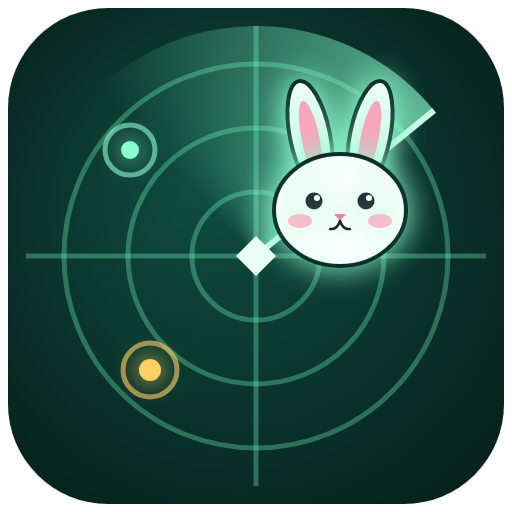
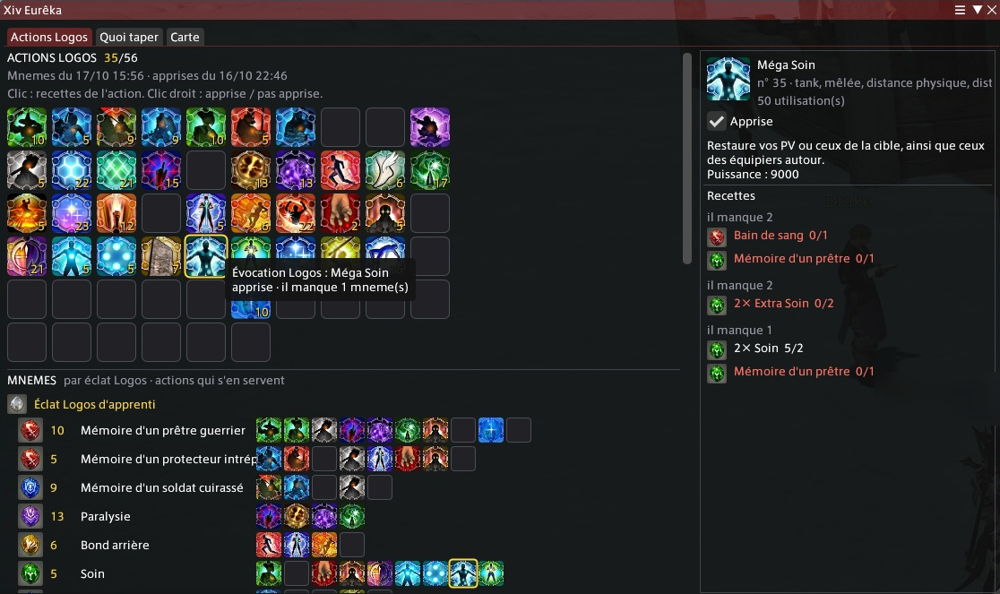

<p align="center">
  
</p>

<h1 align="center">Xiv Eurêka</h1>

<p align="center">
  A Dalamud plugin for <b>Eureka</b> (FFXIV): your Logos actions read from the game, what to hit next
  for the logograms you are missing, a live NM map and the ffxiv-eureka.com tracker, in game.
</p>

<p align="center">
  <a href="https://github.com/Pop115/XivEureka/releases/latest"></a>
  <a href="https://github.com/Pop115/XivEureka/releases"></a>
  
</p>

> **English and French.** The plugin speaks French on a French client and English on any other
> (English, German, Japanese); a setting can force either. Item, action, monster and weather names
> come from the game, in your client's language.

## Install

1. In game, type `/xlsettings`, open the **Experimental** tab.
2. Under **Custom Plugin Repositories**, paste this URL in an empty row, tick **Enabled**, then
   click **+** and **Save and Close**:
   ```
   https://github.com/Pop115/XivEureka/releases/latest/download/repo.json
   ```
3. Type `/xlplugins`, search for **Xiv Eurêka** and click **Install**.

Updates then come through `/xlplugins` like any other plugin. Open the window with `/xiveureka`
(or the plugin's button in `/xlplugins`); it also opens by itself at the Logos manipulator.

## What it does

<!-- Screenshots: docs/images/*.png, cropped to the plugin window (no other player's name). -->
<p align="center">
  
</p>

**Logos actions.** The ffxiv-eureka.com logogram page, but with *your* mnemes read from the game:
mnemes by logogram, the 56 actions (learned ones read from Drake's Logos action notebook), and
for each action its recipes and what you are missing. Actions you can craft right now glow.

**What to hit** ("Quoi taper"). From the actions you have not learned, the plugin works out the
missing mnemes, the logograms that give them, and every way to get those logograms: elementals
under their weather, NMs with their live state, bunny FATE coffers, mutation lockboxes, random
drops. Each source gets an estimated time to your first *useful* mneme (waiting for the weather or
the respawn, then tries × time per try, with measured bunny coffer odds and mneme odds), for a
small party farming on its own. "Fastest" sums it up; **Map** and **Flag** buttons take you there.

**Map.** The zone's game map redrawn by the plugin: you, your party, the flag, the NMs with their
state (FATE running, respawning, weather or night to come), the chosen NM's prep area, pops called
in chat. Eorzea time, day/night and the coming weathers on top; "Where to go now" on the side.

**Alerts and tracker.** New NM FATEs and pops called in chat (shout, yell, party, LS, CWLS) raise a
game toast and set the map flag. A ffxiv-eureka.com tracker link seen in chat is followed live;
a button creates one for your instance (never automatically) and NMs you kill are reported on it.

**Server info bar.** A short "Eurêka" entry: Eorzea time and weather in its tooltip, a click opens
the map or the Logos actions.

Zones: the map works in all four Eureka zones; NM and logogram data cover **Pyros** and
**Hydatos** (Anemos and Pagos have no Logos actions).

## Network use

The plugin only talks to **ffxiv-eureka.com**, for the tracker: it reads the instance tracker you
follow (websocket), lists the open trackers of your data center, creates one when you click the
button, and reports NM kills on a tracker it created. Nothing else leaves your game.

## Credits

- [ffxiv-eureka.com](https://ffxiv-eureka.com) for the logogram recipes, NM data and the tracker.
- The Logogram Helper plugin's recipes, used as a cross-check.
- The FFXIV Console Games Wiki, the Eurekan Academy wiki, Noranda La'luna's community maps, the
  community bestiary and drop-record spreadsheets: drop tables, places and odds (sources are listed
  in each `XivEureka/Data/*.json` file).

## License

[AGPL-3.0](LICENSE), like the Dalamud sample plugin: you may use, change and share the code, as long
as what you share stays open under the same license.

Issues and ideas are welcome in [GitHub issues](https://github.com/Pop115/XivEureka/issues).
Building, tests and data notes (in French): [docs/DEVELOPMENT.md](docs/DEVELOPMENT.md).

---

## En français

Un compagnon pour Eurêka dans le jeu : tes actions Logos lues dans le jeu, quoi taper pour les
éclats qui te manquent (avec un temps estimé par source), une carte des NM en direct et le tracker
ffxiv-eureka.com. **En français sur un client français, en anglais sinon** (un réglage permet de
choisir). Licence AGPL-3.0.

**Installer** : `/xlsettings` → onglet **Experimental** → **Custom Plugin Repositories**, coller
`https://github.com/Pop115/XivEureka/releases/latest/download/repo.json`, cocher **Enabled**,
cliquer sur **+** puis **Save and Close** ; ensuite `/xlplugins`, chercher « Xiv Eurêka » et
**Install**. La fenêtre s'ouvre avec `/xiveureka` ou au manipulateur Logos.

Détail technique, données et tests : [docs/DEVELOPMENT.md](docs/DEVELOPMENT.md).
